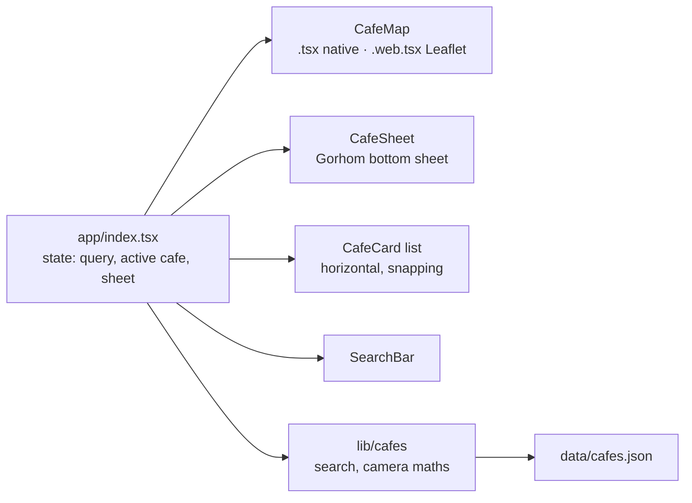

# CafeMap

**English** · [Türkçe](README.tr.md)

A mobile app for finding independent cafes in Istanbul on a map. Tap a pin to see the cafe, browse the cards along the bottom, or search by name, neighbourhood or feature.

[](https://github.com/Beratoguzhan620/cafe-map/actions/workflows/ci.yml)


<p align="center"></p>

## Try it

**Live demo:** [beratoguzhan620.github.io/cafe-map](https://beratoguzhan620.github.io/cafe-map/) (the web version, with a Leaflet map; published from `main` by `.github/workflows/deploy.yml`)

The map uses native map SDKs through `expo-maps`, which Expo Go does not include, so the phone apps need a **development build**. The web version runs without one.

```bash
pnpm install
pnpm web             # in the browser (Leaflet map)
pnpm ios             # npx expo run:ios: builds and opens the iOS simulator (macOS + Xcode)
pnpm android         # npx expo run:android: builds and installs on an emulator or a connected phone
```

### Development build notes

- **iOS** uses Apple Maps and needs no key. The first `pnpm ios` runs `expo prebuild`, installs the pods and builds the app; later runs only start Metro.
- **Android** uses Google Maps, which needs a *Maps SDK for Android* key from the Google Cloud console:
  1. Copy `.env.example` to `.env` and set `GOOGLE_MAPS_API_KEY=...`.
  2. Run `pnpm android`. `app.config.ts` reads the key and writes it into the Android manifest. The key never goes into git.
  Without a key the app still builds, but the map stays blank.
- After changing `app.json`, the icons or a native package, rebuild with `npx expo prebuild --clean` and run again.
- To test on your own phone, connect it over USB (Android: USB debugging on) or pick it with `pnpm ios --device`.

## Features

- **Full-screen map:**
  - All 15 cafes are pinned on a camera that frames them on open.
  - The header sits inside the safe area, so it never goes under the notch or the status bar.
- **Cafe details in a bottom sheet** (Gorhom Bottom Sheet):
  - Shows the photo, name, rating, price level, description, tags, address and opening hours.
  - Opens from a pin or a card; swipe it down or tap close, and the selection clears.
- **Selected pin and camera:**
  - The selected pin turns from coffee to ink and comes to the front.
  - The camera flies to the cafe and leaves it above the sheet.
- **Card list synced with the map:** scrolling the cards moves the map to the card in view and highlights its pin.
- **Search:**
  - Matches names, neighbourhoods, districts and tags; every word has to match.
  - Turkish letters are optional, so `kadikoy` finds *Kadıköy*.
  - The pins and cards update as you type, with an empty state when nothing matches.
- **Light and dark themes** follow the device, for the map as well as the interface.
- **Web fallback:** `expo-maps` has no web support, so the web build uses Leaflet with Esri grey canvas tiles behind the same component interface.
- **App icon and splash:** an original map-pin mark, with Android adaptive icon layers and light and dark splash screens.

## Screenshots

| Map | Cafe | Search | Dark |
|---|---|---|---|
|  |  |  |  |

The screenshots come from the web build. On phones the same screen uses Apple Maps (iOS) or Google Maps (Android).

## Cafe data

The cafes live in [`src/data/cafes.json`](src/data/cafes.json). The neighbourhoods are real, but the cafes and their details are made up for the demo; the cover images are drawn by [`scripts/make-cafe-images.py`](scripts/make-cafe-images.py). One entry:

```json
{
  "id": "kuytu-kahve",
  "name": "Kuytu Kahve",
  "neighbourhood": "Moda",
  "district": "Kadıköy",
  "address": "Moda, Kadıköy, İstanbul",
  "latitude": 40.9842,
  "longitude": 29.0257,
  "rating": 4.7,
  "priceLevel": 2,
  "openingHours": "08:00–23:00",
  "tags": ["Kendi kavurur", "Sessiz"],
  "description": "Moda'nın ara sokaklarında, sekiz kişilik küçük bir dükkân. …",
  "image": "kuytu-kahve.jpg"
}
```

`priceLevel` runs from 1 to 3, and `image` is a file in `assets/cafes/`. To add a cafe, add an entry and its image, and add the image to `src/data/images.ts`; the tests check that every entry is complete and that its image exists.

## Tech stack

- Expo SDK 58 (managed, with a development build), React Native 0.88, expo-router, TypeScript in strict mode
- `expo-maps`: Apple Maps on iOS, Google Maps on Android. Leaflet and react-leaflet on the web.
- `@gorhom/bottom-sheet` with Reanimated and Gesture Handler
- NativeWind (Tailwind): every style is a `className`; CI fails on inline styles. Colours and type come from [docs/DESIGN.md](docs/DESIGN.md), including the dark palette.
- expo-image, lucide-react-native icons and IBM Plex Sans
- Vitest for the data and helpers, Playwright for an end-to-end flow on the web build
- GitHub Actions: type check, lint, inline-style check, unit tests, web build and the end-to-end flow

## How it is built



- The screen keeps three pieces of state: the query, the active cafe and whether the sheet is open. The camera is worked out from them:
  - **Sheet open:** the cafe at zoom 15, moved up so it shows above the sheet.
  - **Browsing cards:** the cafe at zoom 14.
  - **Nothing chosen:** a frame around all the search results.
- `CafeMap` has the same props on every platform. Metro picks `CafeMap.web.tsx` for the web build and `CafeMap.tsx` for the phones.
- The map animates whenever the camera prop changes: `setCameraPosition` on the phones, `flyTo` in Leaflet.

## Scripts

| Command | What it does |
|---|---|
| `pnpm start` | Expo dev server (for a development build) |
| `pnpm ios` / `pnpm android` | Build and run the development build |
| `pnpm web` | Run in the browser |
| `pnpm typecheck` | `tsc --noEmit` |
| `pnpm lint` | ESLint (expo config) |
| `pnpm test` | Unit tests |
| `pnpm build:web` | Static web build in `dist/` |
| `pnpm serve:web` | Serve `dist/` on port 8090 |
| `pnpm test:e2e` | End-to-end flow against the served build |
| `pnpm media:readme` | Record the README screenshots and walkthrough |

## Tests

```bash
pnpm test
```

The unit tests cover:

- **The data:** 15 cafes inside Istanbul, unique ids, every field filled and a bundled image for each.
- **Search:** Turkish letters and case, every word matching, and results kept in order.
- **Camera maths:** the frame around a set of cafes, and the offset that keeps a cafe above the sheet.

The end-to-end flow runs in a real browser on phone and desktop sizes, in light and dark:

- It checks that the map fills the screen, with one pin and one card per cafe.
- Tapping a pin opens the right sheet, highlights the pin and keeps it above the sheet. Closing the sheet clears the selection.
- Tapping a card opens the same sheet, and scrolling the cards moves the highlight.
- Searches filter pins and cards, and the empty state can clear the search.

## Roadmap and known gaps

- Checking the development build on a real iPhone and Android phone.
- Filters for price, rating and opening hours, and the user's own location.
- Clustering pins when there are many cafes.

## Background

This project started as a bootcamp project and was later rebuilt from the ground up. The assignment asked for an Expo app that shows cafes from a JSON file on Expo Maps, opens a Gorhom bottom sheet when a pin is tapped, is styled with NativeWind, and has an app icon, a splash screen and development build notes. What this version adds:

- **Map:** a selected pin that stands out, camera animation that keeps the cafe above the sheet, and Apple Maps and Google Maps from one component.
- **Features:** a card list synced with the map, search that handles Turkish letters, and light and dark themes.
- **Web:** a Leaflet version of the map, so the app runs and is tested in the browser.
- **Design:** a design system shared with my other projects, original cover images and an original icon.
- **Quality:** unit tests, an end-to-end browser flow, an inline-style guard and CI on every pull request.

## License

[MIT](LICENSE) · Berat Oğuzhan Turğut · [GitHub](https://github.com/Beratoguzhan620)
