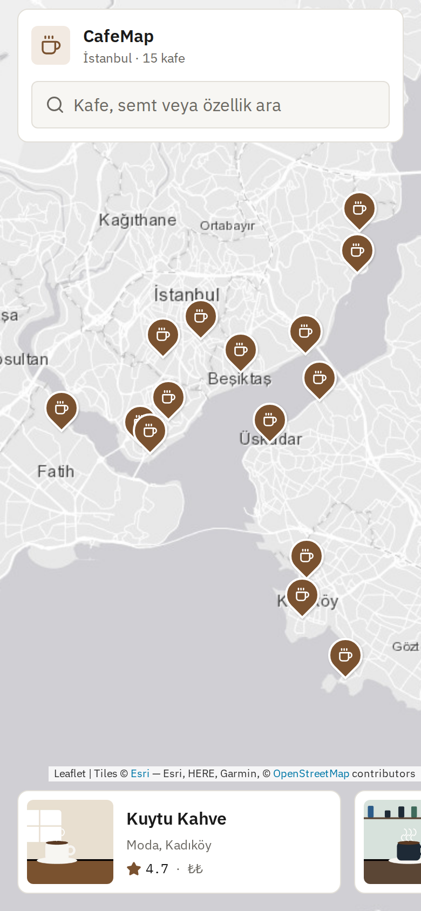
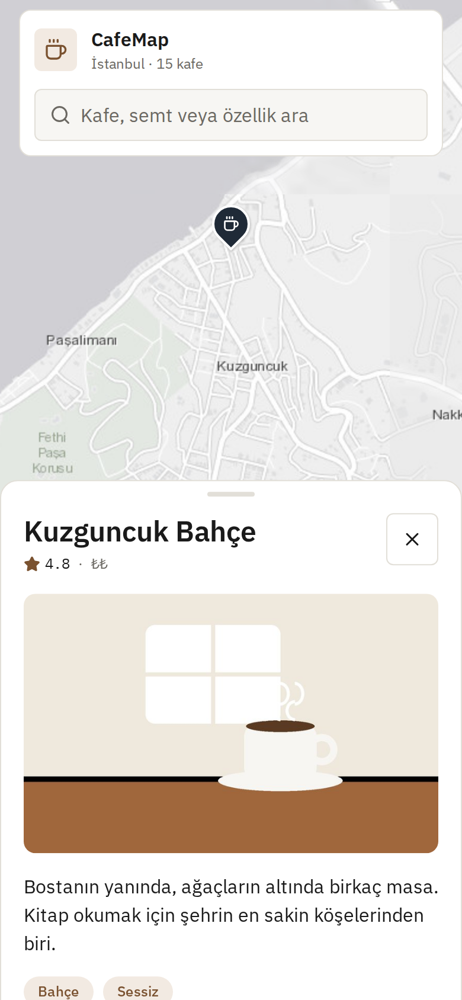
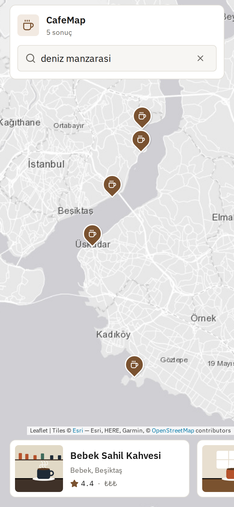
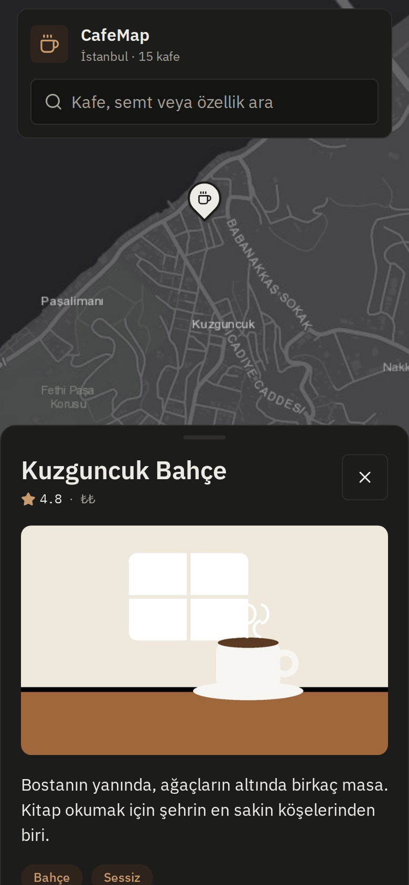
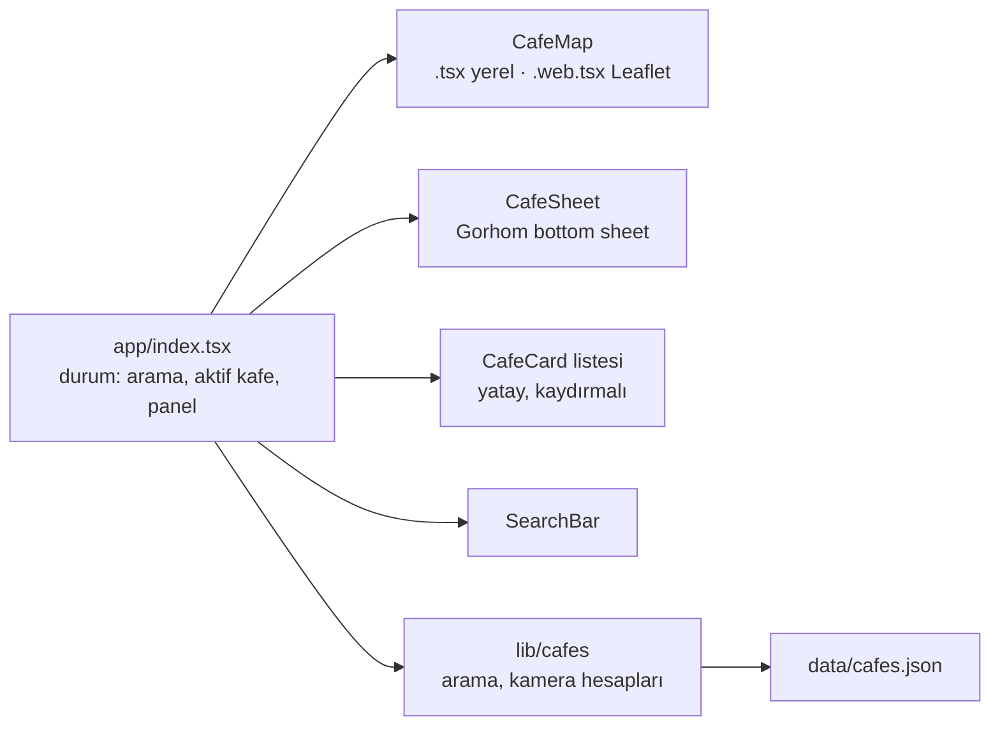

# CafeMap

[English](README.md) · **Türkçe**

İstanbul'daki bağımsız kafeleri harita üzerinde bulmak için bir mobil uygulama. Kafeyi görmek için pine dokun, alttaki kartlarda gez ya da ada, semte veya özelliğe göre ara.

[](https://github.com/Beratoguzhan620/cafe-map/actions/workflows/ci.yml)


<p align="center"></p>

## Deneme

Harita, `expo-maps` üzerinden yerel harita SDK'larını kullanıyor. Expo Go bunları içermediği için telefonda **development build** gerekiyor. Web sürümü buna ihtiyaç duymadan çalışır.

```bash
pnpm install
pnpm web             # tarayıcıda (Leaflet haritası)
pnpm ios             # npx expo run:ios: derler ve iOS simülatöründe açar (macOS + Xcode)
pnpm android         # npx expo run:android: derler ve emülatöre ya da bağlı telefona kurar
```

### Development build notları

- **iOS** Apple Maps kullanır, anahtar gerekmez. İlk `pnpm ios` komutu `expo prebuild` çalıştırır, pod'ları kurar ve uygulamayı derler; sonraki çalıştırmalar sadece Metro'yu başlatır.
- **Android** Google Maps kullanır ve Google Cloud konsolundan alınmış bir *Maps SDK for Android* anahtarı ister:
  1. `.env.example` dosyasını `.env` olarak kopyala ve `GOOGLE_MAPS_API_KEY=...` değerini gir.
  2. `pnpm android` komutunu çalıştır. `app.config.ts` anahtarı okuyup Android manifest'ine yazar; anahtar git'e hiç girmez.
  Anahtar olmadan da uygulama derlenir, ama harita boş kalır.
- `app.json`, ikonlar ya da yerel bir paket değişince `npx expo prebuild --clean` ile yeniden derleyip tekrar çalıştır.
- Kendi telefonunda denemek için USB ile bağla (Android'de USB hata ayıklama açık olmalı) ya da `pnpm ios --device` ile cihazı seç.

## Özellikler

- **Tam ekran harita:**
  - 15 kafenin hepsi pinli; açılışta kamera hepsini kadraja alır.
  - Başlık güvenli alanın içinde durur, çentiğin ya da durum çubuğunun altına girmez.
- **Alt panelde kafe ayrıntısı** (Gorhom Bottom Sheet):
  - Görsel, ad, puan, fiyat seviyesi, açıklama, etiketler, adres ve çalışma saatleri.
  - Pinden ya da karttan açılır; aşağı kaydırınca ya da kapatınca seçim sıfırlanır.
- **Seçili pin ve kamera:**
  - Seçili pin kahve renginden mürekkep rengine döner ve öne çıkar.
  - Kamera kafeye uçar ve onu panelin üstünde bırakır.
- **Haritayla senkron kart listesi:** kartlar kaydırıldıkça harita görünen karttaki kafeye gider ve pinini vurgular.
- **Arama:**
  - Ad, semt, ilçe ve etiketlerde arar; her kelime eşleşmeli.
  - Türkçe karakter şart değil: `kadikoy` yazınca *Kadıköy* bulunur.
  - Pinler ve kartlar yazarken güncellenir; sonuç yoksa boş durum gösterilir.
- **Açık ve koyu tema** cihazı takip eder; hem arayüz hem harita için.
- **Web yedeği:** `expo-maps` web'i desteklemediği için web sürümü aynı bileşen arayüzünün arkasında Leaflet ve Esri gri harita karolarını kullanır.
- **Uygulama ikonu ve açılış ekranı:** özgün bir harita pini işareti; Android uyarlanabilir ikon katmanları, açık ve koyu açılış ekranı.

## Ekran görüntüleri

| Harita | Kafe | Arama | Koyu |
|---|---|---|---|
|  |  |  |  |

Ekran görüntüleri web sürümünden alındı. Telefonda aynı ekran Apple Maps (iOS) ya da Google Maps (Android) ile çalışır.

## Kafe verisi

Kafeler [`src/data/cafes.json`](src/data/cafes.json) dosyasında. Semtler gerçek, ancak kafeler ve ayrıntıları demo için uyduruldu; kapak görselleri [`scripts/make-cafe-images.py`](scripts/make-cafe-images.py) ile çiziliyor. Bir kayıt:

```json
{
  "id": "kuytu-kahve",
  "name": "Kuytu Kahve",
  "neighbourhood": "Moda",
  "district": "Kadıköy",
  "address": "Moda, Kadıköy, İstanbul",
  "latitude": 40.9842,
  "longitude": 29.0257,
  "rating": 4.7,
  "priceLevel": 2,
  "openingHours": "08:00–23:00",
  "tags": ["Kendi kavurur", "Sessiz"],
  "description": "Moda'nın ara sokaklarında, sekiz kişilik küçük bir dükkân. …",
  "image": "kuytu-kahve.jpg"
}
```

`priceLevel` 1 ile 3 arasındadır; `image` ise `assets/cafes/` içindeki bir dosyadır. Kafe eklemek için kaydı ve görselini ekleyip görseli `src/data/images.ts` dosyasına yaz; testler her kaydın eksiksiz olduğunu ve görselinin var olduğunu kontrol eder.

## Teknolojiler

- Expo SDK 58 (managed, development build ile), React Native 0.88, expo-router, strict modda TypeScript
- `expo-maps`: iOS'ta Apple Maps, Android'de Google Maps. Web'de Leaflet ve react-leaflet.
- Reanimated ve Gesture Handler ile `@gorhom/bottom-sheet`
- NativeWind (Tailwind): bütün stiller `className`; satır içi stil olursa CI hata verir. Renkler ve yazı tipleri [docs/DESIGN.md](docs/DESIGN.md) dosyasından geliyor (koyu palet dahil).
- expo-image, lucide-react-native ikonları ve IBM Plex Sans
- Veri ve yardımcı fonksiyonlar için Vitest, web sürümünde uçtan uca akış için Playwright
- GitHub Actions: tip kontrolü, lint, satır içi stil kontrolü, birim testleri, web derlemesi ve uçtan uca akış

## Nasıl çalışıyor



- Ekran üç durum tutar: arama metni, aktif kafe ve panelin açık olup olmadığı. Kamera bunlardan hesaplanır:
  - **Panel açıkken:** kafe zoom 15'te, panelin üstünde görünecek kadar yukarıda.
  - **Kartlarda gezinirken:** kafe zoom 14'te.
  - **Seçim yokken:** bütün arama sonuçlarını içine alan bir kadraj.
- `CafeMap` her platformda aynı prop'ları alır. Metro web derlemesinde `CafeMap.web.tsx`, telefonlarda `CafeMap.tsx` dosyasını seçer.
- Kamera prop'u her değiştiğinde harita animasyonla gider: telefonlarda `setCameraPosition`, Leaflet'te `flyTo`.

## Komutlar

| Komut | Ne yapar |
|---|---|
| `pnpm start` | Expo geliştirme sunucusu (development build için) |
| `pnpm ios` / `pnpm android` | Development build'i derleyip çalıştırır |
| `pnpm web` | Tarayıcıda çalıştırır |
| `pnpm typecheck` | `tsc --noEmit` |
| `pnpm lint` | ESLint (expo yapılandırması) |
| `pnpm test` | Birim testleri |
| `pnpm build:web` | `dist/` klasörüne statik web derlemesi |
| `pnpm serve:web` | `dist/` klasörünü 8090 portunda sunar |
| `pnpm test:e2e` | Sunulan derlemeye karşı uçtan uca akış |
| `pnpm media:readme` | README ekran görüntülerini ve tanıtım kaydını alır |

## Testler

```bash
pnpm test
```

Birim testleri şunları kapsar:

- **Veri:** İstanbul sınırları içinde 15 kafe, benzersiz id'ler, eksiksiz alanlar ve her kafe için paketlenmiş bir görsel.
- **Arama:** Türkçe karakterler ve büyük/küçük harf, her kelimenin eşleşmesi ve sonuç sırasının korunması.
- **Kamera hesapları:** bir grup kafeyi içine alan kadraj ve kafeyi panelin üstünde tutan kaydırma.

Uçtan uca akış gerçek bir tarayıcıda, telefon ve masaüstü boyutlarında, açık ve koyu temada çalışır:

- Haritanın ekranı kapladığını ve her kafe için bir pin ve bir kart olduğunu kontrol eder.
- Pine dokununca doğru panelin açıldığını, pinin vurgulandığını ve panelin üstünde kaldığını; panel kapanınca seçimin sıfırlandığını doğrular.
- Karta dokununca aynı panel açılır; kartlar kaydırılınca vurgu da kayar.
- Aramalar pinleri ve kartları süzer; boş durumdaki düğme aramayı temizler.

## Yol haritası ve eksikler

- Development build'in gerçek bir iPhone ve Android telefonda denenmesi.
- Canlı web demosu.
- Fiyat, puan ve çalışma saati filtreleri; kullanıcının kendi konumu.
- Kafe sayısı artınca pinlerin kümelenmesi.

## Arka plan

Bu proje bir bootcamp projesi olarak başladı, sonra baştan geliştirildi. Ödev; kafeleri bir JSON dosyasından Expo Maps üzerinde gösteren, pine dokununca Gorhom bottom sheet açan, NativeWind ile stillenmiş, uygulama ikonu, açılış ekranı ve development build notları olan bir Expo uygulaması istiyordu. Bu sürümde eklenenler:

- **Harita:** öne çıkan seçili pin, kafeyi panelin üstünde tutan kamera animasyonu, tek bileşenden Apple Maps ve Google Maps.
- **Özellikler:** haritayla senkron kart listesi, Türkçe karakterleri anlayan arama, açık ve koyu tema.
- **Web:** haritanın Leaflet sürümü; uygulama tarayıcıda da çalışıyor ve test ediliyor.
- **Tasarım:** diğer projelerimle ortak bir tasarım sistemi, özgün kapak görselleri ve özgün bir ikon.
- **Kalite:** birim testleri, uçtan uca tarayıcı akışı, satır içi stil denetimi ve her pull request'te CI.

## Lisans

[MIT](LICENSE) · Berat Oğuzhan Turğut · [GitHub](https://github.com/Beratoguzhan620)
